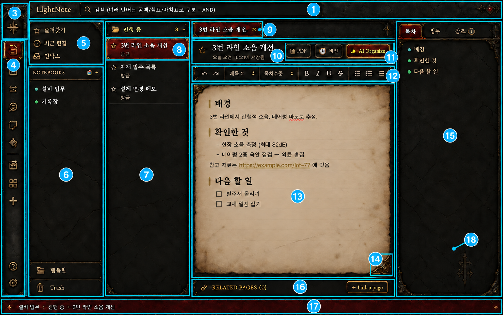

# Fantasy Reference Kit v1 — 목표 화면 에셋 배치도

이 문서는 목표 화면의 번호와 `fantasy-reference-kit-v1` 폴더 안 에셋을 연결한다. 텍스트·숫자·목록 내용은 이미지에 굽지 않고 앱에서 렌더링한다. 프레임의 권장 9-slice 값은 `manifest.json`을 기준으로 사용한다.

## 번호별 대응표

| 번호 | 화면 구역 | 주로 사용할 이미지 | 보조 이미지·적용 메모 |
|---:|---|---|---|
| 1 | 앱 상단 제목·검색 영역 | `header-search-shell.png` | 앱 이름, 검색 아이콘과 검색어는 런타임 렌더링. 가로 길이는 9-slice로 확장한다. |
| 2 | 최좌측 세로 버튼 레일 | `rail-shell.png` | 레일 배경에 세로 9-slice 적용. 중앙에는 4번 아이콘과 상태판을 겹친다. |
| 3 | 레일 상단 나침반 문장 | `rail-crest.png` | 32–48px 범위에서 비율 유지. 배경판 없이 레일 위에 단독 배치한다. |
| 4 | 레일 아이콘과 선택 상태 | `icon-rail-*.png` | 기본은 아이콘만, 호버는 `rail-button-hover.png`, 선택은 `rail-button-active.png`를 아이콘 아래에 겹친다. |
| 5 | 즐겨찾기·최근 편집·인박스 | `icon-star-off.png`, `icon-star-on.png`, `icon-clock.png`, `icon-inbox.png` | 즐겨찾기 전후는 동일 위치에서 `star-off ↔ star-on`만 교체. 구역 분리는 `divider-h.png`. |
| 6 | 노트북 트리·템플릿·휴지통 | `panel-frame.png`, `stone-tile.png` | 제목 바는 `section-bar.png`; 폴더·휴지통은 `icon-folder.png`, `icon-folder-open.png`, `icon-trash.png`. 패널 프레임은 9-slice. |
| 7 | 현재 폴더의 페이지 목록 | `panel-frame.png`, `stone-tile.png` | 상단 폴더 헤더에는 `section-bar.png`; 비선택 행은 이미지 없이 투명/텍스트 중심으로 구성한다. |
| 8 | 선택된 페이지 행 | `row-active.png` | 가로 9-slice. 행의 별은 `icon-star-off.png` 또는 `icon-star-on.png`; 제목과 시간은 앱에서 렌더링한다. |
| 9 | 활성 문서 탭 | `tab-active.png` | 제목과 닫기 표시는 런타임 렌더링. 비활성 탭은 배경 없이 어두운 면과 얇은 구분선만 사용한다. |
| 10 | 편집기 제목·저장 시간 영역 | `editor-title-strip.png` | 즐겨찾기 상태는 `icon-star-off.png`/`icon-star-on.png`. 제목과 메타 정보는 앱에서 렌더링한다. |
| 11 | PDF·버전·AI 동작 버튼 | `button-default.png`, `button-primary.png` | PDF·버전은 기본 버튼, AI Organize는 주요 버튼. 아이콘·글자는 런타임에서 중앙 정렬한다. |
| 12 | 서식 도구 모음 | `editor-toolbar-strip.png` | 도구 그룹 사이에는 `divider-h.png`를 짧게 잘라 사용하거나 CSS 선으로 처리. 서식 아이콘은 앱 아이콘 체계를 유지한다. |
| 13 | 본문 양피지 | `paper-sheet.png` | 줄이 필요할 때만 `paper-lines.png`를 위에 겹친다. 양피지 위 텍스트는 어두운 갈색으로 앱에서 렌더링한다. |
| 14 | 양피지 모서리 장식 | `paper-corner-compact.png` | 좌상단 원본을 회전·반전해 네 귀퉁이에 사용. 더 긴 장식이 필요하면 `paper-corner-tl.png`를 대안으로 사용한다. |
| 15 | 우측 목차·업무·참조 패널 | `panel-frame.png`, `stone-tile.png` | 선택 탭 배경은 `tab-active.png`; 하단 중앙 장식은 `panel-finial.png`. 항목의 색 점은 CSS 원형으로 처리한다. |
| 16 | 관련 페이지 하단 바 | `footer-related.png` | 오른쪽 링크 버튼은 `button-default.png`, 링크 아이콘은 `icon-link.png`. 본문 폭에 맞게 가로 9-slice. |
| 17 | 최하단 breadcrumb 상태바 | `status-bar.png` | 경로 텍스트와 구분 기호는 앱에서 렌더링. 창 전체 폭에 맞게 중앙 구간만 늘린다. |
| 18 | 공통 패널 프레임·검정 석재 재질 | `panel-frame.png`, `stone-tile.png` | 6·7·15번 패널뿐 아니라 중앙 편집기 외곽에도 공유. `panel-frame.png`는 테두리, `stone-tile.png`은 내부 반복 채움이다. |

## 아이콘 파일 구성

### 레일 기본 아이콘 16개

`icon-rail-search.png`, `icon-rail-note.png`, `icon-rail-work.png`, `icon-rail-workflow.png`, `icon-rail-chat.png`, `icon-rail-sticky.png`, `icon-rail-ai.png`, `icon-rail-calendar.png`, `icon-rail-grid.png`, `icon-rail-plus.png`, `icon-rail-help.png`, `icon-rail-gear.png`, `icon-rail-star.png`, `icon-rail-folder.png`, `icon-rail-inbox.png`, `icon-rail-link.png`

### 상태 아이콘 16개

`icon-star-off.png`, `icon-star-on.png`, `icon-folder.png`, `icon-folder-open.png`, `icon-clock.png`, `icon-inbox.png`, `icon-trash.png`, `icon-link.png`, `icon-check-off.png`, `icon-check-on.png`, `icon-pin-off.png`, `icon-pin-on.png`, `icon-caret-left.png`, `icon-caret-right.png`, `icon-close.png`, `icon-more.png`

## 상태 조합 규칙

| 상태 | 아래쪽 배경 | 위쪽 아이콘 |
|---|---|---|
| 레일 기본 | 없음 | `icon-rail-*.png` |
| 레일 호버 | `rail-button-hover.png` | `icon-rail-*.png` |
| 레일 활성 | `rail-button-active.png` | `icon-rail-*.png` |
| 즐겨찾기 전 | 행 배경 유지 | `icon-star-off.png` |
| 즐겨찾기 후 | 행 배경 유지 | `icon-star-on.png` |
| 체크 전/후 | 행 배경 유지 | `icon-check-off.png` / `icon-check-on.png` |
| 고정 전/후 | 행 배경 유지 | `icon-pin-off.png` / `icon-pin-on.png` |

## 구현 우선순위

1. `stone-tile.png`과 `panel-frame.png`으로 전체 골격을 먼저 맞춘다.
2. `header-search-shell.png`, `rail-shell.png`, `status-bar.png`으로 앱 외곽을 완성한다.
3. 행·탭·버튼 등 선택 상태 에셋을 적용한다.
4. 양피지와 모서리 장식을 배치한다.
5. 마지막에 아이콘과 텍스트를 올려 크기와 대비를 조정한다.

## 주의사항

- `paper-lines.png`는 선택형 오버레이이므로 기본 양피지에 합치지 않는다.
- 선택 적색은 `row-active`, `tab-active`, `button-primary`, `rail-button-active`, `status-bar`, `badge`에만 사용한다.
- `star-off/on`, `check-off/on`, `pin-off/on`은 중심 좌표를 바꾸지 않고 파일만 교체한다.
- 생성 원판인 `rail-icons-atlas.png`, `state-icons-atlas.png`는 참고·재추출용이며 실제 UI에서는 개별 128×128 파일을 사용한다.

## 번호 이미지 생성 정보

- 방식: 내장 이미지 편집
- 편집 대상: 사용자가 첨부한 최종 목표 화면
- 변경 범위: 청록색 구역선, 번호 원, 최소한의 지시선만 추가
- 원본 UI의 배치·문자·재질은 유지
